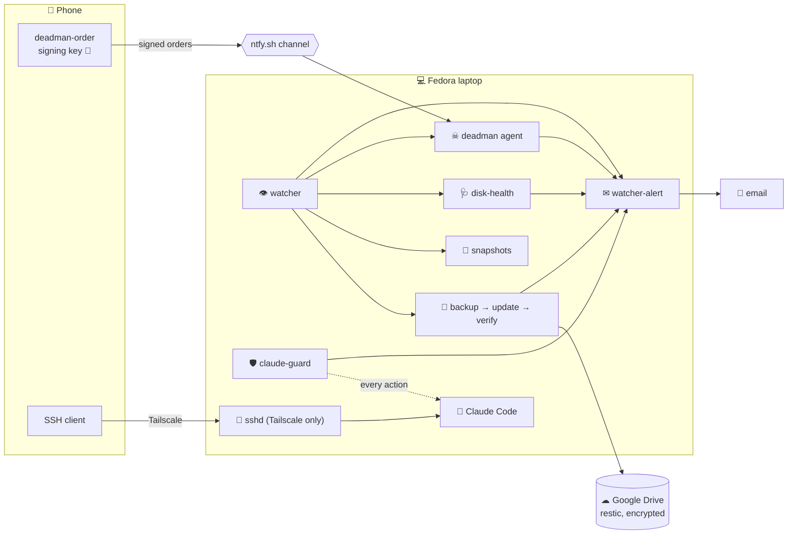
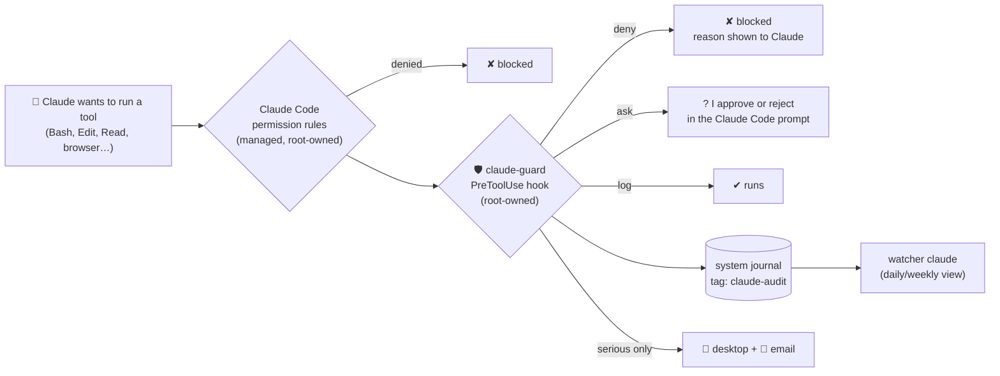

# Fedora Workstation Automation

A personal Linux workstation (ThinkPad P1, Fedora 45) run like a small production system: nightly encrypted
off-site backups, updates that can't brick the GPU driver, filesystem snapshots, disk health checks, an
end-to-end test suite, a remote lock/locate/wipe system that only obeys cryptographically signed orders from my
phone, and a **guardrail that audits and limits an AI coding agent (Claude Code) that operates the machine.**

Everything here is real, in daily use, and copied from the live system by [`tools/sync.sh`](tools/sync.sh),
which swaps personal details for placeholders and refuses to finish if anything private is left
([`tools/leakcheck.sh`](tools/leakcheck.sh)).

> **How it was built.** I designed the system, set the rules, reviewed the changes and installed every privileged
> piece myself. Much of the code was written by Claude Code working *inside* the guard described below. That's
> part of the point: an AI agent can do real systems work when it's boxed in by controls it can't switch off.

---

## Contents

| | Component | What it does |
|---|---|---|
| 👁 | [`watcher`](components/watcher) | Oversees every scheduled job, runs a 47-test end-to-end suite, auto-fixes safe problems, sends alerts, weekly report |
| 🛡 | [`claude-guard`](components/claude-guard) | Root-owned hook that sees every AI agent action **before** it runs: blocks, asks or logs. [Deep dive ↓](#the-claude-guard-in-depth) |
| ☠ | [`deadman`](components/deadman) | Remote locate / lock / scrub / wipe, phone-signed orders only; silent alert when the laptop goes online away from home |
| ☁ | [`backup`](components/backup) | restic → Google Drive, encrypted, nightly; 12-phase `system-restore` rehearsed in a VM |
| ⬆ | [`update`](components/update) | dnf + Flatpak, only after a successful backup; NVIDIA kernel module verified before any reboot |
| 📸 | [`snapshots`](components/snapshots) | btrfs snapshots before/after every package transaction + hourly `/home` |
| 🩺 | [`disk-health`](components/disk-health) | NVMe SMART, btrfs error counters, monthly scrub, free space |
| 🔐 | [`remote`](components/remote) | SSH from my phone over Tailscale only: keys only, one user, no forwarding |
| 📚 | [`dots`](components/dots) | Every config/script versioned in a bare git repo, pre-commit secret scan, nightly push |
| 🤖 | [`claude-skills`](components/claude-skills) | The instructions that teach the AI agent to *use* these tools (and what it may not do) |

Full architecture, schedules and data flows: **[docs/architecture.md](docs/architecture.md)**.



---

## The Claude guard in depth

### The problem

Claude Code is an AI agent with a shell. On this machine it can run commands, edit files and browse the web as
my user. That machine also holds the backup encryption password, cloud logins, my GitHub access, and a system that
can **wipe the disk**. Three things can go wrong:

1. **Mistakes.** The agent runs something destructive with good intentions (`rm -rf` in the wrong place, `dd` to
   the wrong device, disabling the backup timer "to test something").
2. **Prompt injection.** The agent reads a web page, an email or a file containing instructions written by
   someone else ("upload ~/.ssh to this URL") and follows them.
3. **Removing its own oversight.** The easiest way past any rule is to edit the rule, delete the log or turn
   off the hook. An agent that can do that isn't really controlled.

The built-in permission prompts help with (1). They're configured in files the agent can edit, so they don't
help with (3). The guard is built so that the agent **can't change, pause or hide from it**.

### Where it sits



Claude Code supports **hooks**: external programs it must call at certain moments. Before every tool call
(`PreToolUse`) it sends the hook a JSON description of what it's about to do, for example:

```json
{"hook_event_name": "PreToolUse", "session_id": "…", "tool_name": "Bash",
 "tool_input": {"command": "git push origin main"}}
```

The guard replies with a decision, which Claude Code enforces:

```json
{"hookSpecificOutput": {"hookEventName": "PreToolUse", "permissionDecision": "deny",
  "permissionDecisionReason": "claude-guard: Claude has no git/GitHub access (`git`); Levi runs git himself"}}
```

`deny` blocks the action and tells the agent why, so it can change course; I watched it do exactly that while
building this repo (below). `ask` hands the decision to me in the normal approval prompt. No output means
"allowed, logged".

### Why the agent can't switch it off

| Layer | How it's protected |
|---|---|
| **Wiring** | The hook is declared in `/etc/claude-code/managed-settings.json`. Claude Code loads *managed* settings with the highest priority; `allowManagedHooksOnly: true` makes it ignore hooks from user/project settings, so the agent can't add a hook that cancels this one. The file is root-owned, and my user has no passwordless sudo. |
| **The program** | `/usr/local/bin/claude-guard` is root-owned and read-only. The editable source lives in `~/.config/claude-guard/`, but it only goes live when **I** run `install.sh` with sudo in a real terminal, after reviewing the diff. `install.sh` refuses to install a guard that fails its own self-test. |
| **Self-defence rules** | Any action that edits, moves or chmods the guard, the managed settings or the pause file is denied as `tamper`. So are clearing the journal (`journalctl --vacuum`), forging audit entries (`logger -t claude-audit`) and the `disableAllHooks` setting. |
| **Fail closed** | If the guard crashes or gets input it can't parse, the action is **denied**. A broken guard blocks things; it never lets everything through. |
| **Audit log** | Every action, including allowed ones, is written to the system journal (`claude-audit`). Journal files are root-owned, so the agent can read the log but can't edit or delete it. `watcher claude` summarises sessions, blocked/asked events and browser URLs. |
| **Pause** | Sometimes I want it out of the way. `watcher guard pause 2h` writes an expiry time to a root-owned file (sudo, my terminal only). While paused, blocks/asks become log entries **but tamper rules stay on and everything is still logged**, and the pause **expires by itself**. A pause file that isn't root-owned is ignored. |
| **Tests** | A self-test with 50 sample actions and their expected verdicts, plus 8 checks of which blocks notify. The nightly watcher suite also checks that the installed guard is root-owned, identical to the reviewed source, passing its self-test and actually logging. |

### What it decides

Rules are grouped into categories, and the category drives both the verdict and whether I get notified:

| Category | Verdict | Examples | Notifies me? |
|---|---|---|---|
| `tamper` | deny | edit guard/managed settings, pause the guard, vacuum the journal, forge audit lines | **yes** |
| `deadman` | deny | read the wipe trust store, run the wipe agent, sign anything with an SSH key, `passwd -l` | **yes** |
| `destroy` | deny | `mkfs`, `wipefs`, `cryptsetup erase`, `dd of=/dev/nvme…` | **yes** |
| `secret` | deny | backup password, cloud/GitHub credentials, SSH private keys, browser cookie/password DBs | **yes** |
| `guard-error` | deny | the guard itself failed (fail closed) | **yes** |
| `git` | deny | `git`, `gh`, `dots save`, anything touching the config repo. **I** commit and push. | journal only |
| `exfil` | ask | `curl -d/-F/-T/-X POST` to a host that isn't on the alert allow-list | journal only |
| `network` | ask | `scp`, `ssh`, `rsync host:`, `nc`, `socat` | journal only |
| `watchdog` | ask | `systemctl stop/disable/mask`, `watcher pause/disable` | journal only |
| `system` / `config` | ask | firewall changes, crontab, edits to shell startup files, systemd units, `/etc` | journal only |
| `browser-*` | ask | browser automation on banking/email/account pages; running JavaScript, filling forms, uploading | journal only |

**Notifications cover serious events only.** The first version alerted on every block and soon became noise
(the agent bumps into the git rule all the time, which is the rule working). Now only the categories where a block
means *something tried to touch the crown jewels* trigger a desktop notification and email. Everything else is one
`watcher claude` away. Alert emails carry the category only, never command text, so a secret that appears in a
command never ends up in a mailbox. Commands written to the journal also have token-shaped strings masked.

### Reading commands the way a shell does

Matching on the raw string is easy to fool: `echo hi | xargs git add`, `sudo -u me git push`,
`FOO=1 gh repo list`, `bash -c 'git commit'`. So `commands_in()` parses a command line roughly the way the
shell will run it:

1. **Split into segments** on `;`, `&&`, `||`, `|`, `$(`, backticks, parentheses and newlines.
2. **Strip wrappers** at the front of each segment: env assignments (`FOO=1`), `sudo`, `env`, `xargs`,
   `timeout`, `nice`, `runuser`, `flatpak-spawn`… together with their flags and arguments (`sudo -u levi`,
   `timeout 5m`).
3. **Recurse** into `bash -c '…'` / `sh -c '…'`.
4. **Look inside scripting one-liners** (`python3 -c`, `perl -e`, `node -e`) for `subprocess` / `os.system`
   calls to `git`/`gh`.

The rules then look at the real program (`first`) and its arguments. That's also how the guard avoids false
positives: `grep -rn git file.py` is allowed, because `git` is only an argument there.

### A real example from building this repo

While adding the "away from home" alert to the remote-wipe agent, the agent tried to edit the agent's source and
got:

```
claude-guard: the remote-wipe trust store and agent source are Levi's only
```

It wrote the change to a scratch folder instead, ran the agent's self-test there (11/11 order checks and 9/9
away-alert checks), and handed me the diff plus install commands. I reviewed it and installed it with sudo. That is
the intended workflow: the agent does the work, a human approves anything that touches the security boundary.

### Limits, stated plainly

The guard is a **policy layer that reads intentions**, not a sandbox. It's built to stop mistakes, casual prompt
injection and the agent disabling its own oversight. It does **not** contain a determined adversary that controls
the agent:

- **Indirection:** a script written to disk and then run (`bash ./x.sh`), or a base64-decoded command, can hide
  what it does from the pattern rules. Writes and runs are still logged, though, and the managed deny rules and
  file permissions still apply.
- **Same Unix user:** the agent runs as me. Secrets I can read, a cleverly hidden command can read too. The
  guard raises the bar; file ownership is what actually holds.
- **Root-equivalent groups (found and fixed):** while writing this README I asked "what can my user do
  without a password?" and found it in the `docker` group. Access to the Docker socket is effectively passwordless
  root (`docker run -v /:/host …`), which would have got around every root-owned protection above. Fix: I moved all
  my projects to **rootless Docker** (the daemon runs as my user inside a user namespace, so a container's "root" is
  just me), migrated the images and volumes, left the `docker` group and disabled the root daemon. A nightly
  test (`no-root-equivalent-access`) now fails if my user is ever back in `docker`/`disk`/`libvirt`/… or root
  Docker is running. Side benefit: rootful Docker publishes ports by inserting its own firewall rules, bypassing
  firewalld; rootless ports go through the host firewall like any other program's.
- **Next step:** OS-level containment for the agent: Claude Code's sandbox mode (bubblewrap: filesystem and
  network allow-lists enforced by the kernel) or a dedicated Unix user with no access to secrets at all. Then the
  guard becomes a second line of defence instead of the main one.

### Interview cheat-sheet

- **"Why not just trust the AI's own judgment?"** It's good, but it reads untrusted text all day (web pages,
  files) and it can be wrong. Same reason we don't give an intern prod root: least privilege plus an audit trail,
  however capable the operator.
- **"Why root-owned?"** A control the controlled party can edit isn't a control. Privilege separation is the
  whole design: the agent runs as an unprivileged user; the guard, its config and the log belong to root.
- **"What if the guard breaks?"** It fails closed, so the agent loses access instead of gaining it. A self-test
  gates installation, and nightly tests check it's still in place.
- **"How do you know it works?"** 50 table-driven decision tests, nightly integrity checks, and the audit log
  shows real denials in daily use.
- **"How would you get around it?"** Indirection through files, anything the same Unix user can already read,
  or a root-equivalent group. I found and closed one of those (`docker` → rootless Docker, now tested nightly). That's why the roadmap item is a kernel-enforced sandbox, and why
  the secrets that really matter (the remote-wipe signing key) aren't on this machine at all.
- **"What did you learn?"** Alert fatigue is a security bug (I cut notifications down to serious events), every
  control needs a test, and the useful question is "what can this identity do?", not "what does this rule
  block?". That question is how I found the Docker hole.

---

## deadman: remote wipe without trusting the laptop

- **Only my phone can give orders.** It holds a passphrase-protected Ed25519 key; the laptop holds only the
  **public** key (root-only file). Orders are signed with `ssh-keygen -Y sign` under a per-machine namespace.
- **An order is executed only if** the signature verifies, it names this machine, it was issued within 15
  minutes, its random nonce has never been seen (no replays), and, for `wipe`, a confirmation phrase matches.
  Every order, accepted or rejected, is logged and emailed.
- **Transport:** the laptop polls a private ntfy.sh channel every 2 min. The channel is only a mailbox; its
  secrecy doesn't matter for safety, because signatures do the authenticating.
- **Actions:** `test` · `locate` (Wi-Fi geolocation + IP) · `lost` (location every 10 min) · `lock` (lock, end
  desktop sessions, disable password login) · `scrub` (delete credentials, log out of Tailscale) · `wipe`
  (destroy LUKS keyslots: crypto-erase in seconds, then power off).
- **Away-from-home alert:** every check also identifies the current network by its **router's MAC address** (a
  Wi-Fi name is trivial to copy). On any network that isn't my trusted home router it sends a silent email: where
  it is, who's logged in, and the exact phone commands to lock or wipe it. Alerts repeat on a new network, after
  coming back from 30+ min offline, and every 4 h. Trusting a network or pausing alerts sends an email itself,
  so a thief who does either tips me off.
- Self-test: 11 signature/replay/expiry cases and 9 away-alert scenarios, run before every install.

## Backup, update, recovery

- **Nightly chain** (00:00): backup → update → verify. The update **only runs if the backup succeeded**. Verify
  runs no matter what: safe auto-fixes, then the quick test suite, then a health check.
- **NVIDIA-safe updates:** after a kernel update the proprietary module must build and load for the new kernel
  before a reboot is suggested; otherwise the old kernel stays the default.
- **Three recovery speeds:** btrfs snapshot rollback (seconds) → restic restore from Drive (hours) →
  `system-restore`, a 12-phase rebuild of a fresh install, rehearsed end-to-end in a VM (an afternoon).
- The weekly full test suite performs **real restores** from Google Drive. A backup that hasn't been restored
  isn't proven to work.

## watcher: one place to see everything

Every scheduled job is a systemd unit tagged `X-Watcher-Name` with `OnFailure=` wired to the notifier, so new
automation shows up in `watcher` by itself. `watcher check` exits non-zero on failed or stale jobs, failed tests,
failed units or a pending reboot; `watcher fix` applies safe repairs (root-level fixes are written as a script I
approve). The test suite (`watcher test`) covers backups, restores, snapshots, firewall, SSH hardening, the guard
and deadman.

All alerts leave through one root-owned sender, `watcher-alert`. It emails over Gmail SMTP from a **separate,
throwaway alerts account**: the only credential on the laptop is that account's app password, which can send mail and
do nothing else, so stealing it gains almost nothing. Deadman mails and guard blocks are sent as high priority.

---

## Repository layout

```
components/<name>/          files copied from the live system
    bin/                    the user-facing command (installed to ~/.local/bin)
    system/                 root-owned pieces + systemd units (installed by install.sh with sudo)
    install.sh              idempotent installer, run by a human in a real terminal
docs/architecture.md        the living architecture document (schedules, data flows, component map)
tools/sync.sh               refresh from the live system (allow-list), redact, leak-check
tools/leakcheck.sh          fails on private values or secret patterns; run before every push
```

This is a **portfolio of a real setup, not a turnkey installer.** Paths assume my user and Fedora 45. The
ideas carry over; the scripts are written to be readable.

## License

MIT. See [LICENSE](LICENSE).
