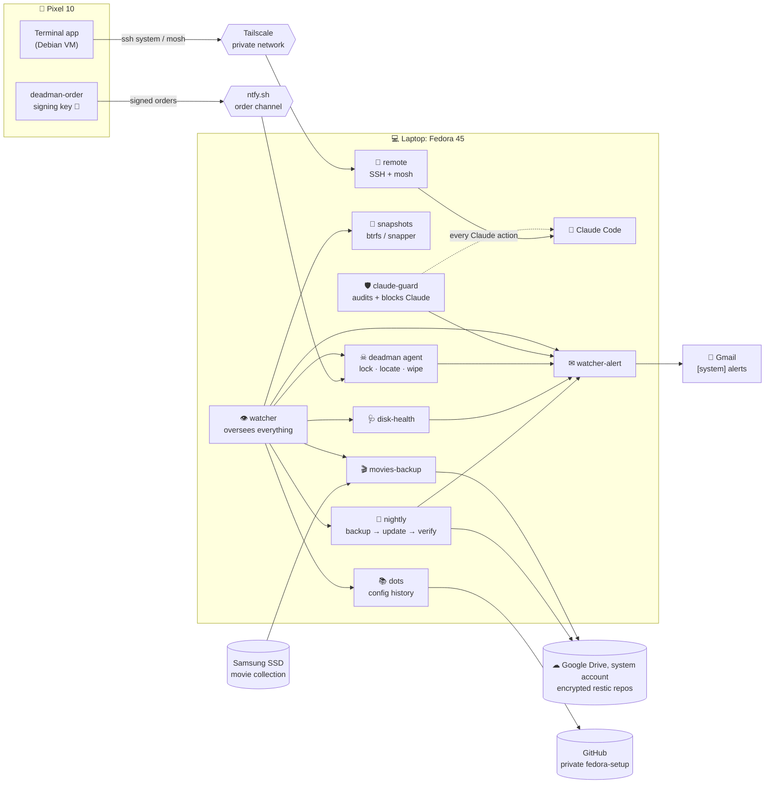
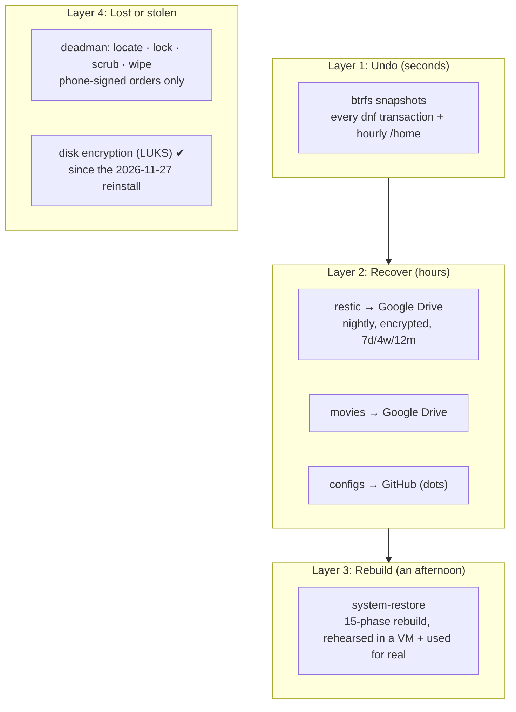
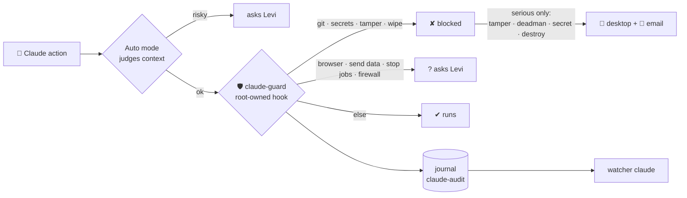
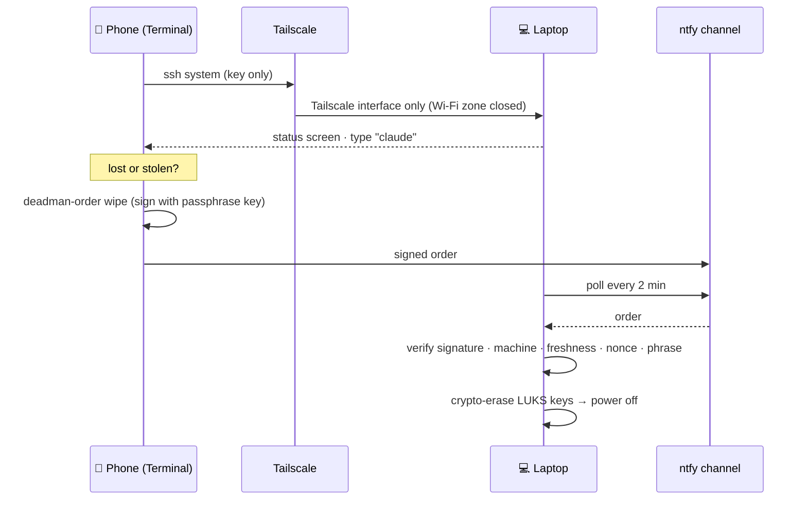

# System Architecture

*Levi's Fedora workstation (ThinkPad P1 Gen 4i) and the automation built around it. A living document: updated whenever something is added or changed.*

**Last updated:** 2026-11-25 · **OS:** Fedora 45 Workstation · **Overseer:** `watcher` · **AI operator:** Claude Code (guarded)

---

## 1. The big picture

---

## 2. What runs when

```mermaid
gantt
    title A normal day
    dateFormat HH:mm
    axisFormat %H:%M
    section Nightly chain
    backup to Drive            :00:00, 2m
    update (dnf + flatpak)     :00:02, 3m
    verify (fix → test → check):00:05, 2m
    section Daily
    movies-backup (if SSD in)  :01:30, 10m
    disk-health                :12:00, 2m
    dots autosave              :23:30, 1m
    section Continuous
    snapshots (hourly)         :00:00, 24h
    deadman agent (every 2 min):00:00, 24h
```

| When | Job | What it does |
|---|---|---|
| 00:00 daily | **nightly** | 1. **backup**: encrypted restic snapshot of `/home` + `/etc` + package manifest → Google Drive 2. **update**: dnf + Flatpak, only if the backup succeeded; NVIDIA module verified before any reboot 3. **verify**: safe auto-fixes → quick tests → health check (always runs) |
| 01:30 daily + on plug-in | **movies-backup** | Samsung SSD → its own encrypted restic repo on Drive (root, system unit) |
| 12:00 daily | **disk-health** | NVMe SMART, btrfs errors, monthly scrub, free space, SSD health |
| 23:30 daily | **dots** | commit + push config/script changes to GitHub |
| hourly | **snapshots-hourly** | btrfs snapshot of `/home` (24 h · 7 d · 4 w kept) |
| every dnf run | *(dnf hook)* | before/after btrfs snapshot of `/` |
| every 2 min | **deadman** | check for phone-signed orders |
| on SSD change | **movielist** | keep the movie list on the SSD current |
| Sun 12:00 | **backup-verify** | root: real restores from Drive (system + movies), compared with the live files → verify.json |
| Sun 12:30 | **tests** | full end-to-end test suite (reads the restore results) |
| Sun 13:00 | **report** | weekly summary email |

---

## 3. Protection layers

---

## 4. Keeping the AI in check

Claude Code operates this machine, from the desk or from the phone. It is useful *because* it is constrained.

- **Managed settings** (`/etc/claude-code/managed-settings.json`, root): the guard hook plus `allowManagedHooksOnly`. Nothing can override it.
- **claude-guard** (`/usr/local/bin/claude-guard`, root): 50 self-tested decisions. It fails closed.
- **Notifications:** desktop + email only for serious blocks (tamper, deadman, secrets, disk destruction, guard errors). Routine blocks/asks (git, network, config edits) go to the journal only.
- **No root-equivalent groups:** Docker is rootless (the `docker` group was passwordless root and bypassed all of the above). Test `no-root-equivalent-access` enforces it.
- **Audit log:** the system journal, tag `claude-audit`. Claude can read it but can't edit it.
- **Pause:** only Levi, with sudo in a real terminal (`watcher guard pause`). Logging continues and the pause expires on its own.
- **Tests** check nightly that the guard is installed, root-owned, unmodified, deciding correctly and actually logging.

---

## 5. Remote access and remote wipe

- **SSH:** keys only, `levi` only, no forwarding (so the phone's keys can never be used from the laptop), Tailscale only. Verified from `sshd -T`.
- **deadman:** the laptop holds only the **public** key, so nothing on it, Claude included, can forge an order. Actions: `test` · `locate` · `lost`/`found` · `lock`/`unlock` · `scrub` · `wipe`.
- **Away alert:** every 2-min check identifies the network. "Home" = the router's MAC **and** home's public IP together (a copied MAC on another network doesn't pass; a home router whose public IP can't be confirmed for ~10 min counts as away). On anything but home it sends a high-priority email (location, who's logged in, the exact phone orders). Trusting home and pausing alerts are **phone-only** signed orders (`trust` / `untrust` · `away-pause 3d` / `away-resume`), so nobody at the keyboard can silence it. Tested on a phone hotspot 2026-11-25.

---

## 6. Component reference

| Component | Command / skill | Source (`~/.config/…`) | Installed | Watched job |
|---|---|---|---|---|
| Overseer | `watcher` · `/watcher` | `watcher/` | `~/.local/bin/watcher`, `/usr/local/bin/watcher-{fix,notify,gate,alert}` | verify |
| Backup | `backup` · `/backup` | `backup/` | `/usr/local/bin/system-backup` | nightly, backup |
| Update | `update` · `/update` | `update/` | `/usr/local/bin/system-update` | update |
| Snapshots | `snapshots` · `/snapshots` | `snapshots/` | snapper + dnf actions hook | snapshots-hourly, snapshots-cleanup |
| Disk health | `watcher info disk-health` | `disk-health/` | `/usr/local/bin/disk-health` | disk-health |
| Tests | `watcher test` | `watcher/tests.py` | (user) | tests |
| Weekly report | `watcher report` | `watcher` | (user) | report |
| Movies backup | `movies-backup` | (script) | `~/.local/bin` | movies-backup |
| Movie list | `movielist` | (script) | `~/.local/bin` | movielist |
| Config history | `dots` · `/dots` | `dots/` | bare repo `~/.dotfiles` → GitHub | dots |
| Restore | `system-restore` | `backup/system-restore` | (fresh system) | (none) |
| Rehearsal | `rehearsal` | (script) | libvirt VM in Boxes | (none) |
| Claude guard | `watcher claude` · `watcher guard` | `claude-guard/` | `/usr/local/bin/claude-guard` | (tests) |
| Remote access | `remote` · `watcher remote` | `remote/` | sshd drop-in, Tailscale, firewalld `tailnet` | (tests) |
| Remote wipe | `deadman` · `/deadman` | `deadman/` | `/usr/local/bin/deadman-agent` | deadman |
| Alerts | `watcher alerts [test\|setup]` | `watcher/alerts.conf` | `/usr/local/bin/watcher-alert` (Gmail SMTP, separate alerts account) | (all) |
| Docker | `docker` (rootless) | (none) | `systemctl --user docker`, data in `~/.local/share/docker` | (tests) |
| Showcase | `tools/sync.sh` | `~/Projects/fedora-workstation-automation` | public GitHub repo (redacted copy) | (none) |
| DVD tools | `ripit` · `ripdvd` · `burnit` · `mkdvdiso` · `/ripit` · `/burnit` | (scripts) | `~/.local/bin` | (none) |
| Terminal | `ll` · `cat` (bat) · `h` · `tailf` | `~/.bashrc.d/` | (shell) | (none) |

**Every watched job:** nightly · backup · update · verify · disk-health · movielist · movies-backup · backup-verify · snapshots-hourly · snapshots-cleanup · tests · report · dots · deadman

---

## 7. Where data lives

| Data | Lives on | Copies |
|---|---|---|
| Home folder, `/etc`, package manifest | NVMe (btrfs) | hourly snapshots · nightly Drive (restic) |
| Movie collection | Samsung SSD (exFAT) | Drive (restic, own repo) |
| Configs + scripts | `~/.config`, `~/.local/bin` | GitHub (dots) · Drive · snapshots |
| Backup credentials (restic password, Drive login) | **`/etc/backup`, root 700 only** (every restic job runs as root, since 2026-11-27) | password manager (off-device) |
| Other secrets (GitHub login, SSH keys, alert app password) | 600 files, never in git, guard-blocked for Claude | password manager (off-device) |
| Claude activity | system journal | (n/a) |
| Docker images + volumes | `~/.local/share/docker` (rootless) | **not backed up**: images rebuild; export volumes to `~/docker-export` before a reinstall |

---

## 8. Roadmap

- [x] **Email alerts, option 2:** a separate alerts Gmail, sent over SMTP with curl (ntfy no longer forwards email anonymously)
- [x] **Encrypted reinstall** (2026-11-27) using `system-restore`: LUKS on, everything restored
- [ ] **deadman:** re-pair the phone after the reinstall, then test the chain (wipe is now a real crypto-erase)
- [ ] **Sandbox mode** for Claude Code (OS-level limits on top of the guard)
- [ ] **Development framework / suite** *(future)*

---

## 9. Changelog

| Date | Change |
|---|---|
| 2026-11-24 | Terminal colors, Zed tweaks · restic → Google Drive backup · NVIDIA-safe nightly update · Flatpaks → RPMs · VS Code, Déjà Dup, Proton VPN removed · `watcher` overseer · btrfs snapshots · disk-health · test suite · pause · nightly verify + fixer · `watcher commands` · dots/GitHub · tight firewall zone · Claude guard |
| 2026-11-25 | Movie backup to Drive (150 GiB) · `system-restore` + VM rehearsal (passed) · guard pause · phone access (Tailscale, `ssh system`, Claude in tmux) · `deadman` remote lock/locate/wipe · central email alerts · `/dots` · this document · deadman away-from-home alert (router-MAC trust) · guard notifies on serious blocks only · rootless Docker (closed a root-equivalent `docker` group) · alerts via a separate Gmail over SMTP · `system-restore` phases `deadman` + `docker` and a "Before wiping" checklist · public showcase repo |
| 2026-11-27 | **Encrypted reinstall** (LUKS) and full restore with `system-restore` (15 phases incl. new `nvidia`, `deadman`, `docker`) · NVIDIA 620 built for every kernel before reboot · restore fixes (dconf locked keys, failed phases shown ✘, zstd version pin, kmod packages) · Bootstrap section in RESTORE.md · new `identity` phase: a reinstall keeps machine-id, SSH host keys, Tailscale node and deadman pairing, so the phone needs no changes · deadman-wipe test procedure · backups moved to a separate system Google account (server-side copy, verified), personal account holds no backups or laptop login |
